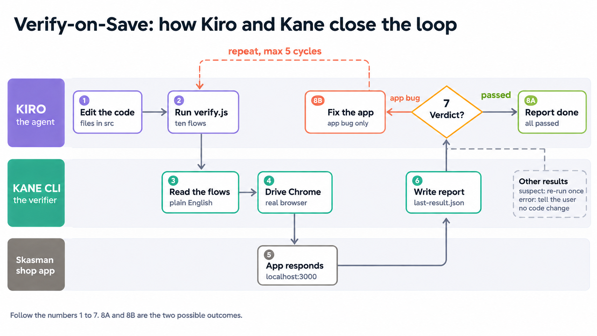

# Verify-on-Save

A drop-in template that closes the loop between an AI coding agent and Kane CLI: the agent changes code, Kane verifies it in a real browser, and the agent reads Kane's report and fixes what failed, until everything passes.

Built for the KaneCLI Online Hackathon with Kiro.

The demo app is **Skasman**, a small skincare shop: a product shelf, size and quantity pickers, a price summary, a pay button with a receipt, and a "My vouchers" popup with promo-code rules. Voucher math is exactly the kind of logic where a one-character bug looks fine at a glance.

## How it works

1. The agent (Kiro) edits the app.
2. A steering rule tells it to run `node scripts/verify.js`.
3. The script runs plain-English Kane flows against `http://127.0.0.1:3000` and writes `.verify/last-result.json`.
4. If a flow fails, the agent reads Kane's `reason_code` and `summary`, fixes the cause, and re-runs (max 5 cycles).
5. It may report "done" only after a passing result.

An optional Kiro hook (`.kiro/hooks/verify-with-kane.json`) can re-run the check after the agent edits source files. Note: Kiro file hooks react to changes made by the agent, not to manual saves.

## What Kane checks

Ten plain-English flows in `scripts/verify.js`:

| Flow | What it proves |
|---|---|
| `size-price` | Choosing 100 ml changes the pay button to $49.30 |
| `pay-quantity-total` | Quantity 2 gives Pay $58.00 and a receipt with the same total |
| `price-summary` | Subtotal, Discount, Shipping and Total are always visible |
| `vouchers-popup` | The "My vouchers" dialog lists codes with their notes |
| `promo-welcome-one-item` | WELCOME10 discounts only 1 item |
| `promo-flat-120` | SAVE20 takes a flat $20.00 off an order of $120.00 or more |
| `promo-invalid` | A wrong code is rejected and the price is unchanged |
| `promo-not-eligible` | A serum code is refused for a non-serum product |
| `promo-buy3` | BUY3SAVE10 is accepted at exactly 3 items |
| `promo-buy6-three-items` | With 6 items, only 3 get 10% off |

You can run a subset: `node scripts/verify.js promo-buy3 size-price`.

## Quick start

Requirements: Node.js, Chrome, Kiro (or Kiro Crew), a TestMu AI account.

```bash
npm install -g @testmuai/kane-cli
kane-cli login
npm install
npm start                  # demo app on http://127.0.0.1:3000
node scripts/verify.js     # run all Kane flows
```

A full run takes a few minutes and uses roughly 120 Kane credits.

Open the folder in Kiro and ask it to change something. The steering file `.kiro/steering/verify-with-kane.md` makes it verify its own work.

## Use it in your own project

1. Copy `.kiro/` and `scripts/` into your repo (keep `scripts/package.json`, see Notes).
2. Edit the `FLOWS` list in `scripts/verify.js` with your own plain-English objectives and set `APP_URL`.
3. Adjust the `matcher` in the hook to your source files.

## Demo: Kane catches a subtle bug

The voucher BUY3SAVE10 promises "Buy 3 or more". `scripts/demo-bug.js` changes one comparison in `src/components/ui/skincare-product-shelf.tsx` (`qty < v.minQty` becomes `qty <= v.minQty`). The app still looks normal, and buying 6 still works, but a customer who buys exactly 3 is wrongly rejected.

Only the `promo-buy3` flow fails. Kane reports `assertion_error.confirmed_product_bug`, Kiro reads the report, changes the line back, re-runs, and the flow passes with Pay $78.30.

```bash
node scripts/demo-bug.js                                        # inject the bug
node scripts/verify.js promo-buy3                               # Kane fails
git checkout src/components/ui/skincare-product-shelf.tsx       # reset
```

See `docs/example-failed-result.json` for a real failed run.

## Notes

- `assertion_error.*` reason codes are treated as app bugs; other codes are treated as infrastructure problems and the agent must not change app code.
- A "passed" status is not trusted blindly. If Kane reports passed but its summary says the task could not be completed or confirmed, `verify.js` marks the flow `SUSPECT` and the overall result as failed. This guards against false passes.
- `verify.js` prints `ERROR` when Kane cannot run at all (for example, an expired login), so a broken setup is never counted as a pass.
- `scripts/package.json` sets `"type": "commonjs"` so the scripts run even though the app's own `package.json` uses ES modules.
- Each Kane run consumes credits, so the hook is limited to source files.

Live demo: https://verify-on-save.vercel.app/

## Demo video
https://youtu.be/0ELXQwoe02Y